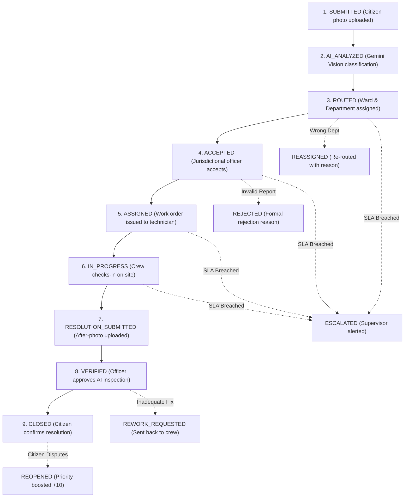

# 🏛️ Community Hero — Citizen-to-Government Civic Action Platform

A complete, full-stack municipal operations and civic problem resolution platform that connects citizen reports directly to responsible municipal departments, jurisdictional ward officers, and field repair technicians.

---

## 1. User Roles & Access Control

The platform provides role-based authentication, dedicated dashboards, and specialized operational permissions for four distinct roles:

| Role | Operational Scope | Dedicated Portal | Demo Credentials |
| :--- | :--- | :--- | :--- |
| **CITIZEN** | Report issues with photo, track 10-stage lifecycle, community verification, final resolution confirmation / dispute | `/dashboard`, `/report` | `citizen.priya@example.com` |
| **DEPARTMENT_OFFICER** | Triage incoming reports, accept cases, reject/reassign departments, generate work orders, assign field workers, review AI resolution verification | `/authority` | `officer.roads@city.gov` |
| **FIELD_WORKER** | Mobile-first repair console, accept work orders, check-in on site, interactive GPS map, upload after-repair photographic proof, submit completion notes | `/worker` | `worker.ramesh@city.gov` |
| **MUNICIPAL_ADMIN** | City-wide strategic overview, ward management, department performance, personnel rosters, ward heatmap, overdue escalation desk, audit trail | `/admin` | `admin@city.gov` |

> [!TIP]
> **One-Click Role Demonstration Switcher**:
> Judges and evaluators can switch roles instantly using the floating **Role Switcher** in the top navigation bar or the quick-login buttons on `/login`.

---

## 2. Deterministic Department & Ward Routing Engine

When a citizen reports a civic problem, the system determines the responsible municipal authority through a deterministic routing service (`src/lib/routing.ts`):

1. **Spatial Ward Jurisdiction**:
   - Compares incident coordinates $(lat, lng)$ against boundary centroids for Bengaluru wards:
     - **Ward 101**: Indiranagar (East Zone)
     - **Ward 102**: Koramangala (South Zone)
     - **Ward 103**: Whitefield (Mahadevapura Zone)
     - **Ward 104**: HSR Layout (Bommanahalli Zone)
     - **Ward 105**: Jayanagar (South Zone)
     - **Ward 106**: Malleshwaram (West Zone)
2. **Department Registry**:
   - **Road Maintenance** (`DEPT-ROAD`): Potholes, asphalt damage, footpaths (SLA: 72h)
   - **Sanitation** (`DEPT-SAN`): Garbage dumps, overflowing bins, public toilets (SLA: 12h)
   - **Water Supply** (`DEPT-WATER`): Pipeline breaches, leaks, contamination (SLA: 24h)
   - **Drainage** (`DEPT-DRAIN`): Blocked drains, stormwater runoff, culverts (SLA: 48h)
   - **Electrical Department** (`DEPT-ELEC`): Broken streetlights, signal outages, cables (SLA: 48h)
   - **Public Works** (`DEPT-PWD`): Fallen trees, structural hazards, encroachments (SLA: 120h)
3. **Control Desk Fallback**:
   - If AI classification confidence is low ($< 65\%$) or unclassified (`Other`), the complaint is automatically routed to the **Municipal Control Desk** (`DEPT-CTRL`) for human officer triage.

---

## 3. End-to-End 10-Stage Complaint Lifecycle

---

## 4. AI Multimodal Resolution Verification

Located in `src/lib/verification.ts`, this module compares the original complaint photograph with the field technician's after-repair photograph using **Gemini Vision** (`gemini-3.5-flash-lite`).

### Output Schema:
- `issueIdentifiedInOriginal`: Identifies specific defect in original image.
- `isResolved`: Boolean indicating if defect is genuinely fixed.
- `remainingVisibleDamage`: Detail of any residual cracks, debris or hazards.
- `verificationConfidence`: Numerical confidence score between $0.0$ and $1.0$.
- `explanation`: Multimodal reasoning comparing Before and After states.
- `recommendation`: `APPROVE`, `REJECT`, or `MANUAL_REVIEW`.

> [!IMPORTANT]
> **Human-in-the-Loop Safeguard**:
> The system **never** closes a case solely on an AI verdict. The AI inspection report is presented to the authorized Department Officer for official review, followed by Citizen confirmation.

---

## 5. Work Orders & Field Worker Mobile Portal (`/worker`)

Built specifically for municipal field crews:
- Mobile-first responsive card layout.
- One-tap **"Accept Task & Check-In"** to log on-site presence.
- Direct access to site directions via OpenStreetMap Leaflet map.
- Camera integration to capture and upload the **After-Repair Photo**.
- Field progress notes input.

---

## 6. Municipal Administrator Dashboard (`/admin`)

Command center for city commissioners:
- **Spatial Heatmap**: Interactive Leaflet map displaying active incident clusters across all wards.
- **Ward Management**: Ward population, total cases, open backlog, and resolution rates.
- **Department Scorecards**: SLA compliance percentages, supervisor contacts, and active queues.
- **Personnel Roster**: Status and active workloads for all authorized officers and field crews.
- **Overdue Escalation Desk**: Real-time monitor for breached cases with priority elevation.
- **Audit Logs**: Immutable log of every platform action with actor role, timestamp, and metadata.

---

## 7. Database Migration

The full PostgreSQL migration is available in [`supabase/migrations/0007_civic_platform.sql`](file:///c:/Users/shaik/Downloads/vibe2ship-main/vibe2ship-main/supabase/migrations/0007_civic_platform.sql):
- Tables added: `wards`, `departments`, `work_orders`, `ai_verifications`, `notifications`, `audit_logs`.
- Tables expanded: `profiles` (roles: `CITIZEN`, `DEPARTMENT_OFFICER`, `FIELD_WORKER`, `MUNICIPAL_ADMIN`), `issues` (ward, officer, worker, detailed status, deadlines).
- Enabled Supabase Realtime publications.

